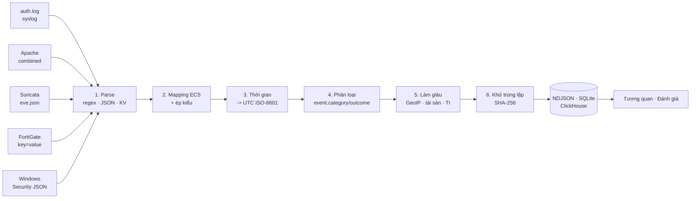

# Chuẩn hóa dữ liệu Giám sát An ninh mạng (GSANM)

Đây là phần thực nghiệm của đề tài **"Nghiên cứu phương pháp chuẩn hóa dữ liệu GSANM"** (đề 16, học phần thạc sĩ,
Học viện Kỹ thuật Mật mã).

Pipeline đọc log từ **5 nguồn** có định dạng, tên trường và múi giờ khác nhau, rồi chuẩn hóa về
**Elastic Common Schema (ECS)**. Sau khi chuẩn hóa, một luật tương quan viết bằng một câu SQL đủ để phát hiện
một chiến dịch tấn công đa giai đoạn.



## Chạy nhanh

```bash
pip install -r requirements.txt
python3 scripts/gen_samples.py      # sinh ~10.000 dòng log mẫu (đã có sẵn trong samples/)
python3 normalize.py                # chuẩn hóa -> output/normalized.ndjson, output/gsanm.db
python3 normalize.py --show 185.220.101.45   # so sánh bản gốc và bản ECS
python3 eval/correlate.py           # trước/sau + luật tương quan đa nguồn
python3 eval/metrics.py             # parse rate, độ phủ trường, EPS -> output/metrics.md
python3 -m pytest -q tests          # kiểm thử
./demo.sh                           # kịch bản demo 5 bước khi thuyết trình
```

Tùy chọn **ClickHouse**:

```bash
docker compose up -d && python3 deploy/load_clickhouse.py
# hoặc không cần Docker:
pip install chdb && python3 deploy/load_clickhouse.py --chdb
```

## Cấu trúc

```
kma-gsanm-normalization/
├── samples/             # log mẫu 5 nguồn (có cài kịch bản tấn công, dòng lỗi, dòng trùng)
├── parsers/             # tầng parse: regex/grok, JSON lồng nhau, key=value
├── schema/
│   └── ecs_mapping.yaml # khai báo mapping trường, kiểu dữ liệu, thời gian, luật phân loại cho từng nguồn
├── enrich/              # GeoIP/ASN, kiểm kê tài sản, threat intel (offline, CSV)
├── normalize.py         # pipeline chính
├── eval/
│   ├── metrics.py       # đánh giá chất lượng chuẩn hóa
│   └── correlate.py     # trước/sau + luật tương quan
├── deploy/              # ClickHouse: DDL, luật tương quan SQL, loader
├── docker-compose.yml   # ClickHouse (tùy chọn)
├── docs/so-sanh-schema.md  # ECS vs OCSF vs CIM vs CEF/LEEF
├── tests/               # pytest
└── demo.sh
```

Thêm nguồn mới **không cần sửa code**: viết một khối khai báo trong `schema/ecs_mapping.yaml`, và chỉ
viết parser mới khi định dạng chưa thuộc regex/JSON/KV.

## Kịch bản tấn công trong dữ liệu mẫu

IP `185.220.101.45` (Tor exit node, có trong threat intel) thực hiện các bước sau, theo giờ Việt Nam:

| Giờ (VN) | Nguồn | Hành vi |
|---|---|---|
| 08:45 | Apache, Suricata | Quét lỗ hổng web bằng Nuclei (`/wp-login.php`, `/.env`, `/.git/config`…) |
| 08:46 | FortiGate | Bị chặn khi dò các cổng 22, 3389, 445, 3306 trên web01 và dc01 |
| 08:47 | auth.log | Brute-force SSH 60 lần (root, admin, oracle…) |
| 08:49 | Windows DC | 25 lần đăng nhập thất bại (Event 4625) |

Mỗi nguồn ghi thời gian theo một cách riêng: giờ địa phương không có năm, `+0700`, UTC, `date`/`time` tách
rời, và epoch ms. Vì vậy, nếu so trực tiếp các mốc thời gian thô, sự kiện của Suricata bị lệch **7 giờ** so
với các nguồn khác.

## Kết quả (dữ liệu mẫu mặc định)

| Nguồn | Dòng | Parse rate | Trùng bị loại | Độ phủ trường lõi |
|---|---:|---:|---:|---:|
| linux_auth | 2.082 | 99,90% | 20 | 95,8%* |
| apache | 2.043 | 99,90% | 20 | 100% |
| suricata | 2.034 | 99,90% | 20 | 100% |
| fortigate | 2.061 | 99,95% | 20 | 100% |
| windows | 2.046 | 99,95% | 20 | 100% |

\* Các dòng `session closed` của sshd không chứa IP nguồn, đúng với bản chất của log này.

Luật tương quan cho ra **1 cảnh báo** duy nhất: IP `185.220.101.45` xuất hiện ở 5/5 nguồn, gồm 158 sự kiện
trong 6 phút, và có trong danh sách Tor exit. Luật không tạo cảnh báo giả nào trên lưu lượng bình thường.
Throughput khoảng 12–15 nghìn EPS (Python đơn luồng). Con số chi tiết của mỗi lần chạy nằm trong `output/metrics.md`.
